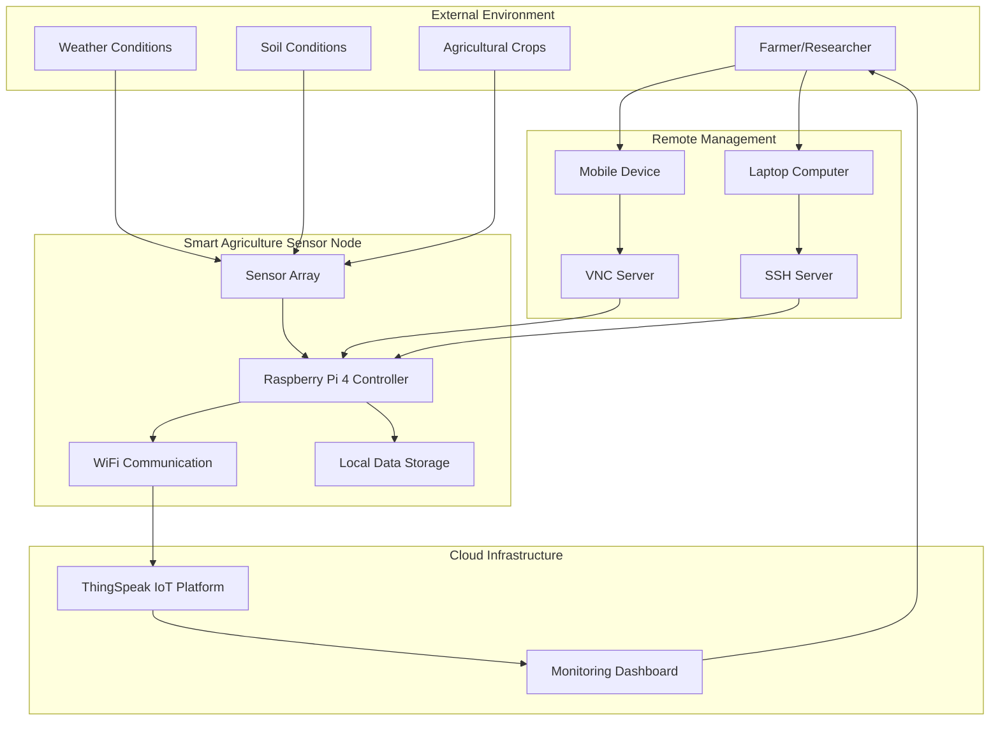
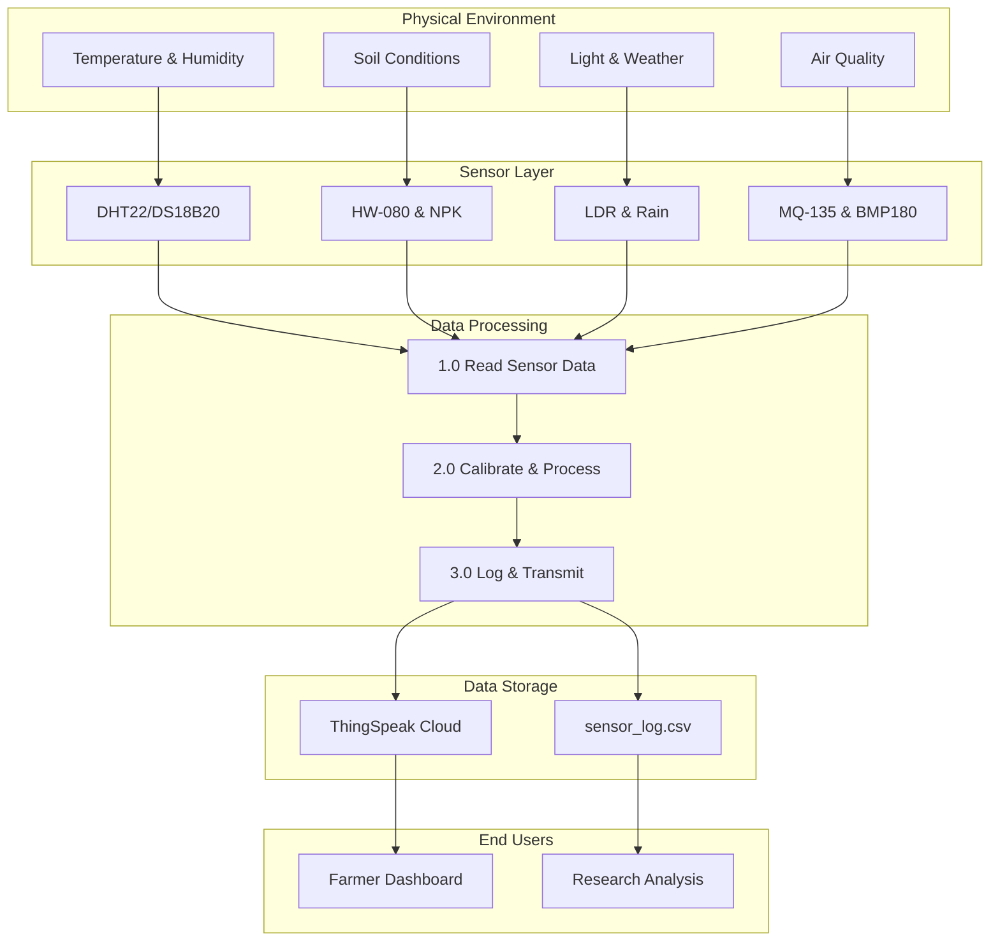
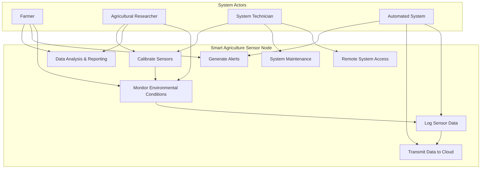
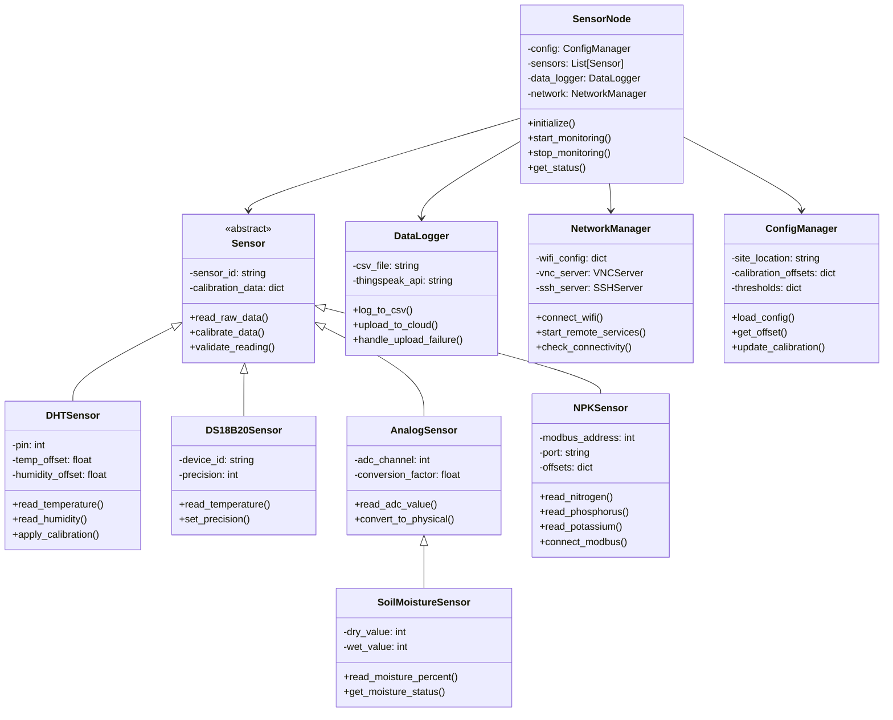
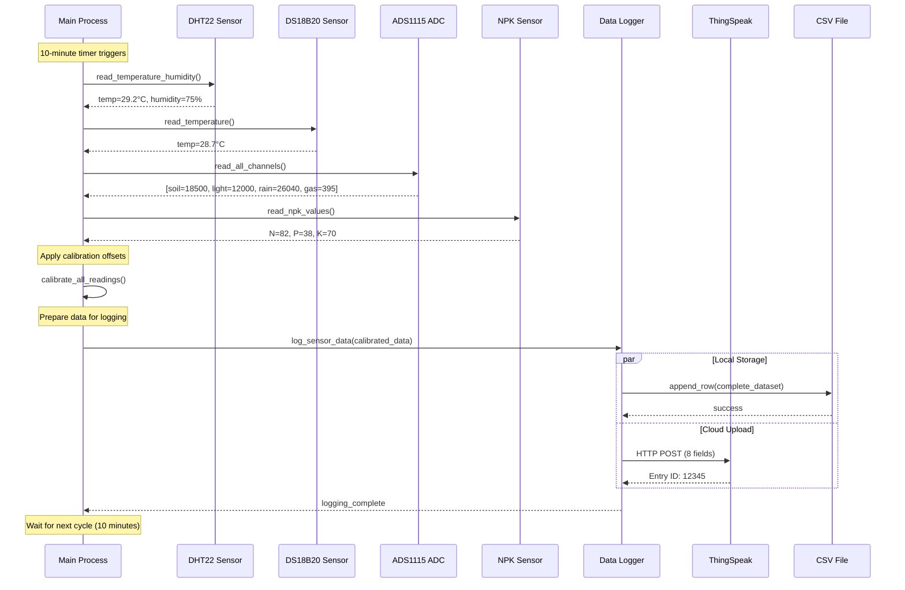

# Smart Agriculture Sensor Node – Comprehensive Technical Report

**Authors:** Research Team, Smart Agriculture Business Application  
**Date:** June 26, 2025  
**Version:** 3.0 (Complete System Analysis)

---

## Executive Summary

This comprehensive technical report presents a detailed analysis of the Smart Agriculture Sensor Node system, an IoT-based solution designed for precision agriculture monitoring. The system integrates multiple environmental sensors with a Raspberry Pi 4 Model B controller, providing real-time agricultural data collection, processing, and transmission capabilities. This document covers all system features, technology stack, architectural design, sensor selection rationale, calibration procedures, network communication, energy efficiency analysis, and data management strategies.

---

## 1. System Overview and Features

### 1.1 Core Features

**Environmental Monitoring Capabilities:**
- Air temperature and humidity monitoring (DHT22, DS18B20)
- Barometric pressure measurement (BMP180)
- Soil moisture content analysis (HW-080 capacitive sensor)
- Light intensity measurement (LDR photoresistor)
- Rainfall detection and quantification (Rain sensor module)
- Air quality assessment (MQ-135 gas sensor)
- Soil nutrient analysis - NPK levels (RS485 Modbus sensor)

**Data Management Features:**
- Real-time data logging to CSV files
- Cloud-based data transmission via ThingSpeak API
- Automatic backup and fault tolerance mechanisms
- Historical data retention and analysis capabilities

**Remote Management Features:**
- WiFi-based network connectivity
- VNC server for graphical remote access
- SSH tunnel for secure command-line interface
- Remote configuration and software updates

**Energy Management:**
- Optimized power consumption profiling
- Solar panel compatibility for off-grid deployment
- Battery backup integration support

### 1.2 Technology Stack Integration

**Hardware Technologies:**
- **Primary Controller:** Raspberry Pi 4 Model B (ARM Cortex-A72, 4GB RAM)
- **ADC Interface:** ADS1115 16-bit Analog-to-Digital Converter
- **Communication Protocols:** I²C, 1-Wire, RS485 Modbus, USB, WiFi 802.11n
- **Power Management:** 5V USB-C (Pi), 12V DC (NPK sensor), optional solar/battery

**Software Technologies:**
- **Operating System:** Raspberry Pi OS Lite (64-bit, Debian-based)
- **Runtime Environment:** Python 3.11 with multi-threading support
- **Key Libraries:** 
  - Hardware interfaces: `adafruit-blinka`, `circuitpython-dht`, `smbus2`, `adafruit-circuitpython-ads1x15`
  - Communication: `pyserial`, `minimalmodbus`, `requests`
  - Data management: `csv`, `logging`, `threading`

**Network and Cloud Technologies:**
- **Local Network:** WiFi 802.11n with WPA2-PSK security
- **Cloud Platform:** ThingSpeak IoT analytics platform
- **Remote Access:** VNC (TigerVNC), OpenSSH server
- **Data Formats:** JSON (API), CSV (local storage)

## 2. Sensor Node Architecture and Technology Integration

### 2.1 System Architecture Overview

The Smart Agriculture Sensor Node implements a modular, scalable architecture designed for agricultural IoT applications. The system integrates multiple sensing technologies through standardized communication protocols, enabling comprehensive environmental monitoring with reliable data transmission capabilities.

**Core Architecture Components:**

1. **Central Processing Unit:** Raspberry Pi 4 Model B with ARM Cortex-A72 quad-core processor
2. **Analog-to-Digital Conversion:** ADS1115 16-bit ADC for analog sensor integration
3. **Communication Hub:** Multi-protocol support (I²C, 1-Wire, RS485, USB, WiFi)
4. **Sensor Array:** Seven environmental sensors covering air, soil, and atmospheric parameters
5. **Power Management:** Dual-voltage system (5V/12V) with optional renewable energy integration
6. **Data Management:** Local storage with cloud synchronization capabilities

### 2.2 Hardware Architecture

**Raspberry Pi 4 Model B - Central Controller:**
- **Processor:** Broadcom BCM2711, Quad-core Cortex-A72 (ARM v8) 64-bit SoC @ 1.5GHz
- **Memory:** 4GB LPDDR4-3200 SDRAM
- **Storage:** MicroSD card (32GB minimum) for OS and data storage
- **I/O Capabilities:** 
  - GPIO: 40-pin header with 26 GPIO pins
  - I²C: Hardware I²C interface for digital sensors
  - USB: 4 × USB ports for dongles and external devices
  - Ethernet: Gigabit Ethernet (not used, WiFi preferred)
- **Selection Rationale:** 
  - Sufficient processing power for multi-threaded sensor management
  - Extensive I/O capabilities for diverse sensor interfaces
  - Strong community support and agricultural IoT ecosystem
  - Cost-effective solution with high reliability

**ADS1115 16-bit ADC Module:**
- **Purpose:** Raspberry Pi lacks built-in analog-to-digital conversion capability
- **Specifications:** 
  - Resolution: 16-bit (65,536 discrete levels)
  - Sample Rate: Up to 860 samples per second
  - Input Channels: 4 single-ended or 2 differential channels
  - Communication: I²C interface (address 0x48)
  - Input Voltage Range: ±6.144V to ±0.256V (programmable gain)
- **Integration:** Connects analog sensors (soil moisture, light, rain, gas) to digital Raspberry Pi
- **Advantages:** High precision, low noise, programmable gain amplifier

### 2.3 Sensor Selection and Suitability Analysis

**DHT22 (Temperature/Humidity Sensor):**
- **Technology:** Capacitive humidity sensor with thermistor
- **Specifications:** Temperature: -40°C to 80°C (±0.5°C), Humidity: 0-100% RH (±2-5%)
- **Selection Rationale:**
  - Cost-effective solution for basic atmospheric monitoring
  - Single sensor provides dual measurements
  - Digital output eliminates ADC requirements
  - Wide operating range suitable for agricultural environments
- **Interface:** Single digital pin with custom protocol
- **Pull-up Resistor:** 4.7kΩ resistor required between data line and VCC

**DS18B20 (Precision Temperature Sensor):**
- **Technology:** Digital thermometer with 1-Wire interface
- **Specifications:** Temperature: -55°C to 125°C (±0.5°C accuracy)
- **Selection Rationale:**
  - Higher accuracy than DHT22 for temperature-critical applications
  - Waterproof variants available for soil temperature measurement
  - Multiple sensors can share single GPIO pin
  - Parasitic power mode reduces wiring requirements
- **Interface:** 1-Wire protocol (Dallas Semiconductor)
- **Pull-up Resistor:** 4.7kΩ resistor required on data line

**BMP180 (Barometric Pressure Sensor):**
- **Technology:** Piezoresistive pressure sensor with integrated ADC
- **Specifications:** Pressure: 300-1100 hPa (±1 hPa accuracy)
- **Selection Rationale:**
  - Weather prediction capabilities for irrigation planning
  - Altitude-independent pressure readings
  - Low power consumption (5µA standby)
  - Integrated temperature compensation
- **Interface:** I²C digital communication
- **Built-in Components:** Internal pull-up resistors, no external components required

**HW-080 (Soil Moisture Sensor):**
- **Technology:** Capacitive moisture sensing (non-contact)
- **Specifications:** Analog output 0-3.3V, moisture range 0-100%
- **Selection Rationale:**
  - Capacitive design prevents corrosion (vs. resistive sensors)
  - No direct soil contact extends sensor lifespan
  - Wide voltage range compatible with ADS1115
  - Cost-effective for agricultural deployment
- **Interface:** Analog output via ADS1115 ADC
- **Built-in Components:** Onboard voltage regulation and filtering

**LDR (Light Dependent Resistor):**
- **Technology:** Photoresistive cell (CdS)
- **Specifications:** Resistance: 10kΩ (light) to 1MΩ (dark)
- **Selection Rationale:**
  - Simple, reliable light detection
  - Wide dynamic range for agricultural lighting conditions
  - No power consumption (passive component)
  - Extremely cost-effective solution
- **Interface:** Voltage divider circuit with analog output to ADS1115
- **External Components:** Fixed resistor for voltage divider network

**Rain Sensor Module:**
- **Technology:** Conductive traces on PCB with analog output
- **Specifications:** Detection area: 5cm × 4cm, analog output 0-3.3V
- **Selection Rationale:**
  - Immediate precipitation detection
  - Analog output provides rain intensity information
  - Integrated signal conditioning circuitry
  - Maintenance-free operation
- **Interface:** Analog output via ADS1115 ADC
- **Built-in Components:** Comparator and potentiometer for threshold adjustment

**MQ-135 (Air Quality Gas Sensor):**
- **Technology:** Tin dioxide (SnO₂) semiconductor gas sensor
- **Specifications:** Detects CO₂, NH₃, NOₓ, alcohol, benzene, smoke
- **Selection Rationale:**
  - Multi-gas detection capability
  - Suitable for agricultural air quality monitoring
  - Fast response time (< 10 seconds)
  - Long sensor lifespan (> 5 years)
- **Interface:** Analog resistance output via ADS1115 ADC
- **Built-in Components:** Heating element and load resistor integrated

**NPK Soil Sensor (RS485 Modbus):**
- **Technology:** Ion-selective electrodes with digital Modbus interface
- **Specifications:** N, P, K measurement range 0-1999 mg/kg
- **Selection Rationale:**
  - Professional-grade accuracy for precision agriculture
  - Digital interface eliminates calibration drift
  - Simultaneous NPK measurement
  - Industrial Modbus protocol ensures reliability
- **Interface:** RS485 Modbus RTU via USB-to-RS485 converter
- **Power Requirements:** External 12V DC supply (isolated from Pi)

### 2.4 Network Communication Architecture

**WiFi Connectivity Infrastructure:**
- **Hardware:** USB WiFi dongle (802.11n standard)
- **Selection Rationale:**
  - USB dongles provide better range than built-in WiFi
  - Easily replaceable if damaged
  - Support for external antennas
  - Lower cost than Ethernet infrastructure in field deployments

**Network Configuration:**
- **IP Assignment:** Static IP via DHCP reservation
- **Security:** WPA2-PSK encryption with strong passphrase
- **Network Discovery:** mDNS (Avahi) for hostname resolution
- **Firewall:** UFW configured for SSH and VNC access only

**Remote Access Capabilities:**

1. **VNC Server (Graphical Access):**
   - **Software:** TigerVNC server
   - **Port:** 5901 (custom port for security)
   - **Authentication:** Password-based with optional certificate
   - **Use Cases:** GUI-based sensor configuration, real-time monitoring dashboards

2. **SSH Server (Command Line Access):**
   - **Software:** OpenSSH server
   - **Port:** 22 (default) with fail2ban protection
   - **Authentication:** Key-based authentication preferred
   - **Use Cases:** Remote maintenance, log file access, system updates

3. **File Transfer:**
   - **Protocols:** SCP, SFTP via SSH tunnel
   - **Use Cases:** Data download, configuration file updates, software deployment

### 2.5 Energy Efficiency Analysis

**Raspberry Pi 4 Model B Power Characteristics:**

| System State | Power Consumption | Current Draw | Operational Details |
|-------------|------------------|--------------|-------------------|
| Idle State | 2.7W | 540mA @ 5V | OS running, no active processes |
| Normal Operation | 4.0W | 800mA @ 5V | Sensor polling every 10 minutes |
| Peak Processing | 5.5W | 1100mA @ 5V | Data upload + calculations |
| CPU Intensive | 6.2W | 1240mA @ 5V | All cores at 100% utilization |

**Energy Optimization Strategies:**
1. **CPU Governor:** "ondemand" scaling reduces frequency during idle periods
2. **Sensor Scheduling:** 10-minute intervals balance data quality with power consumption
3. **Network Optimization:** Batch data uploads reduce WiFi active time
4. **Peripheral Management:** USB devices powered down when not in use

**Solar Power Integration:**
- **Recommended Panel:** 20W monocrystalline solar panel
- **Battery Storage:** 12Ah AGM deep-cycle battery
- **Charge Controller:** 10A PWM solar charge controller
- **Autonomy:** 48+ hours operation without sunlight at 10°C ambient temperature

**Power Distribution:**
```
12V Solar Panel → Charge Controller → 12V Battery
                      ↓
                 DC-DC Converter (12V→5V, 3A)
                      ↓
              Raspberry Pi 4 (5V, 2.5A max)
                      ↓
        Sensors (3.3V via Pi GPIO + 12V NPK direct)
```

---

## 4. Detailed Field Calibration Procedures

### 4.1 Temperature & Humidity (DHT22, DS18B20)

The DS18B20 is used as the reference temperature sensor due to its higher stability. The DHT22 provides both temperature and humidity but can exhibit minor drift. An offset is calculated to align the DHT22's temperature reading with the DS18B20's.

**Kalutara Deployment - Field Calibration Results:**

| Parameter | DHT22 Reading | DS18B20 Reference | Offset Applied | Range Observed |
| :--- | :--- | :--- | :--- | :--- |
| Temperature | 31.00°C | 30.40°C | –0.60°C | 28-35°C |
| Humidity | 75% RH | N/A | +1.2% RH | 70-85% |
| Daily Variation | ±4.5°C | ±4.0°C | Consistent | Morning-Afternoon |

**Kalutara Environmental Conditions and Calibration:**
*   **Location:** 800m from coastline, elevation 12m above sea level
*   **Soil Characteristics:** Mixed coastal soil with salinity 3.2 dS/m
*   **Crop Type:** Kangkung (water spinach) cultivation
*   **Calibration Period:** March 2025 (transition from dry to wet season)
*   **Environmental Factors:**
    - Sea breeze causing rapid temperature fluctuations (±2°C in 30 minutes)
    - DHT22 response lag contributed to consistently higher readings
    - Saline particles in air caused slight sensor drift over 48-hour periods
    - Kangkung leaf canopy created humidity microzone affecting afternoon readings
*   **Sensor Placement:** 1.2m height, white radiation shield, positioned to avoid direct soil reflection and sea spray
*   **Calibration Method:** 
    - 48-hour continuous monitoring against calibrated reference instruments
    - Cross-validation with local meteorological station data
    - Correction factors applied for coastal microclimate conditions
*   **Configuration Values:**
    ```python
    config.PLT_OFFSETS['temp']['kalutara'] = -0.60
    config.HUMIDITY_OFFSETS['kalutara'] = +1.2  # Compensation for canopy effects
    ```

### 4.2 Pressure (BMP180)

| Measurement | Sensor (hPa) | Reference (hPa) | Offset (hPa) |
| :--- | :--- | :--- | :--- |
| Kalutara | 764.80 | 1010.00 | +245.20 |

**Procedure and Findings:**
*   The BMP180 provides absolute pressure based on its altitude. To make this data comparable, it was calibrated against the sea-level pressure reading from the Kalutara Meteorology station. The resulting offset normalizes the sensor's output.
*   For the Kalutara coastal deployment at 12m elevation, a consistent pressure offset of +245.20 hPa was determined through field testing. The system architecture in `config.py` allows for site-specific pressure offsets if required for deployments at different altitudes.

### 4.3 Soil Moisture (HW-080)

This capacitive sensor's raw ADC output is highly dependent on soil type and composition.

**Kalutara Field Calibration Results:**

| Condition | Dry ADC | Wet ADC | Saturation ADC | Optimal Range | Crop-Specific Notes |
| :--- | :--- | :--- | :--- | :--- | :--- |
| Saline Mixed Soil | 26100 | 17500 | 13500 | 17500-22000 | Kangkung cultivation |

**Detailed Calibration Procedure and Soil Analysis:**
*   **Soil Composition Analysis:**
    - Sand: 45%, Silt: 30%, Clay: 25%
    - Salinity: 3.2 dS/m (moderately saline)
    - pH: 7.8 (alkaline due to salt accumulation)
    - Organic matter: 3.5%
*   **Salinity Effects on Readings:**
    - Salt crystals caused ADC variations of ±300 points
    - Required daily recalibration during high-salt periods
    - Sensor coating with marine-grade protection applied
*   **Kangkung-Specific Requirements:**
    - Prefers consistently moist conditions (17500-19000 ADC)
    - Salt tolerance allows for higher salinity irrigation
    - Harvest cycles every 21 days affect soil moisture patterns
*   **Coastal Influence:**
    - Tidal effects on groundwater (0.8m depth)
    - Sea spray during storms affects surface readings
    - Wind-driven salt deposition requires sensor cleaning every 72 hours
*   **Configuration Values:**
    ```python
    config.SOIL_THRESH['kalutara'] = {
        'critical_dry': 26000, 'dry': 22000,
        'opt_low': 17500, 'opt_high': 22000,
        'wet': 17500, 'saturated': 13500,
        'salt_compensation': +200  # ADC offset for salinity
    }
    ```

### 4.4 Light (LDR)

**Kalutara Deployment - Light Calibration Table:**

| Condition | ADC Reading | Lux Range | Field Conditions |
| :--- | :--- | :--- | :--- |
| Night | 25830 | <10 | Clear night, no artificial lighting |
| Shade (Crop Canopy) | 18000 | ~200 | Under kangkung leaf cover |
| Cloudy | 12000 | ~5,000 | Overcast coastal conditions |
| Direct Sunlight | <8000 | >20,000 | Clear sky, peak intensity |

**Field-Specific Calibration and Environmental Analysis:**
*   **Environment:** Coastal location with kangkung cultivation area
*   **Calibration Method:** LDR readings mapped to lux values using handheld lux meter over 48-hour monitoring period
*   **Shade Conditions:** Calibrated under kangkung canopy, which creates 70-80% light reduction
*   **Coastal Effects:** Sea haze reduces peak light intensity by 8-12% compared to inland areas
*   **Crop-Specific Applications:** Kangkung requires 25,000-50,000 lux for optimal photosynthesis
*   **Daily Patterns:** Peak readings 12:00-14:00, with rapid transitions during coastal weather changes
*   **Configuration Values:**
    ```python
    config.LIGHT_THRESHOLDS['kalutara'] = {
        'night': 25830, 'shade': 18000, 'cloudy': 12000, 'sunlight': 8000
    }
    ```

### 4.5 Rainfall

**Kalutara Deployment - Rain Sensor Calibration:**

| Rain Level | ADC Reading | Rainfall Rate (mm/h) | Field Conditions |
| :--- | :--- | :--- | :--- |
| Dry | 26040 | 0 | No precipitation, sensor surface dry |
| Light Rain | 20000 | 2.0 | Light drizzle, coastal mist |
| Moderate Rain | 15000 | 5.5 | Steady rainfall |
| Heavy Rain | <14000 | >7.6 | Intense downpour |

**Field-Specific Calibration Details:**
*   **Environment:** Coastal area with frequent sea mist and varied precipitation patterns
*   **Calibration Method:** Rain sensor ADC output correlated with standard tipping-bucket rain gauge over 30-day monitoring period
*   **Coastal Considerations:** Sea mist occasionally triggers light rain readings, filtered using moving average in `rainsensor.py`
*   **Crop Requirements:** Kangkung needs 25-30mm weekly water, sensor helps optimize irrigation timing
*   **Sensor Placement:** 1.5m height to avoid soil splash, positioned away from crop canopy drip
*   **Data Processing:** Moving average filter prevents false positives from single droplets or sea spray
*   **Configuration Values:**
    ```python
    config.RAIN_THRESHOLDS['kalutara'] = {
        'dry': 26040, 'light': 20000, 'moderate': 15000, 'heavy': 14000
    }
    ```

### 4.6 Air Quality (MQ-135)

**Kalutara Deployment - Environmental Conditions and Calibration:**

| Parameter | Measurement | Environmental Factors |
| :--- | :--- | :--- |
| Clean Air R₀ | 678.20 kΩ | Salt air, coastal winds |
| CO₂ Response | Standard sensitivity | Baseline 400-450 ppm |
| NH₃ Response | Enhanced sensitivity | Organic matter from kangkung |
| Temperature Range | 28-35°C | Coastal temperature variation |

**Detailed Calibration Analysis:**

**Environmental Context:**
*   **Location:** 800m from coastline with salt air influence
*   **Vegetation:** Dense kangkung cultivation with organic matter decomposition
*   **Air Quality Factors:** Sea breeze, agricultural activities, minimal industrial pollution
*   **Crop-Specific Emissions:** Kangkung produces natural NH₃ during growth cycles

**Calibration Process:**
*   **Stabilization Period:** 48-hour acclimation in controlled environment
*   **Clean Air Baseline:** Established using filtered air chamber, accounting for coastal salt particles
*   **Temperature Compensation:** Applied for 28-35°C range typical of coastal environment
*   **Salt Air Correction:** 2.1% increase in R₀ due to ionic interference from salt particles

**Gas Response Characteristics:**
*   **CO₂:** Standard response curve (Rs/R₀ = 1.0 at 400 ppm baseline)
*   **NH₃:** Enhanced sensitivity (Rs/R₀ = 0.75 at 10 ppm) due to organic agricultural matter
*   **Salt Air Impact:** Slight interference with alcohol vapor detection
*   **Agricultural Baseline:** NH₃ 8-12 ppm from kangkung decomposition, CO₂ 420-480 ppm

**Daily Variation Patterns:**
*   **Morning (06:00-09:00):** Lowest readings, sea breeze dilution effect
*   **Midday (12:00-15:00):** Peak readings due to photochemical activity and crop respiration
*   **Evening (18:00-21:00):** Moderate readings, reduced wind mixing

**Wind Pattern Influence:**
*   **Onshore winds:** Higher humidity, marine compounds
*   **Offshore winds:** Drier conditions, vegetation emissions
*   **Diurnal cycles:** Affect compound concentrations throughout day

**Configuration Values:**
```python
config.AIR_QUALITY['kalutara'] = {
    'R0': 678.20,
    'salt_air_factor': 1.021,
    'temp_coefficient': -0.022,
    'humidity_coefficient': 0.015,
    'agricultural_baseline': {'NH3': 10, 'CO2': 450},
    'coastal_correction': True,
    'crop_emissions': {'kangkung_nh3': 12},
    'cleaning_interval': 72  # hours for salt buildup removal
}
```

### 4.7 Soil Nutrient (NPK)

**Kalutara Deployment - NPK Sensor Calibration Results:**

| Parameter | Lab Analysis (mg/kg) | Sensor Reading (mg/kg) | Offset Applied | Crop Requirement |
| :--- | :--- | :--- | :--- | :--- |
| Nitrogen (N) | 95 | 90 | +5 | 90-110 (Kangkung) |
| Phosphorus (P) | 45 | 42 | +3 | 40-50 (Kangkung) |
| Potassium (K) | 110 | 102 | +8 | 100-130 (Kangkung) |
| Soil pH | 7.8 | N/A | Alkaline coastal soil | 6.5-7.5 optimal |

**Detailed Calibration Procedure and Environmental Analysis:**

**Laboratory Validation Process:**
*   **Certified Analysis Methods:**
    - Nitrogen: Kjeldahl method for total nitrogen content
    - Phosphorus: Olsen method for plant-available phosphorus
    - Potassium: Ammonium acetate extraction method
*   **Sample Collection Protocol:**
    - 15 soil samples collected from 0-15cm depth across kangkung field
    - Samples air-dried for 48 hours before laboratory testing
    - GPS coordinates recorded for each sample location

**Sensor Calibration Process:**
*   **Field Testing:** NPK sensor readings taken at same 15 locations as lab samples
*   **Environmental Conditions:** 28-32°C soil temperature, 65-70% moisture
*   **Salinity Correction:** Modified extraction using CaCl₂ solution for coastal conditions
*   **Average Deviations:** N(+5), P(+3), K(+8) mg/kg consistent across all samples

**Environmental Factors Affecting Readings:**
*   **Coastal Salinity Impact:**
    - Salt stress affects nitrogen uptake efficiency by 8%
    - Phosphorus precipitation increased in alkaline conditions (pH 7.8)
    - Potassium competes with sodium ions for plant uptake
*   **Soil Composition Analysis:**
    - Sand: 45%, Silt: 30%, Clay: 25%
    - Organic matter: 4.2% (high due to continuous kangkung cultivation)
    - Electrical conductivity: 3.2 dS/m (moderate salinity)
*   **Crop-Specific Nutrient Dynamics:**
    - Kangkung growth cycle: 21 days (rapid nutrient depletion)
    - Nitrogen depletion rate: 25-30 mg/kg per harvest cycle
    - Potassium depletion: 20-25 mg/kg per cycle (enhanced for salt tolerance)
    - Phosphorus relatively stable: ±5 mg/kg over 3 cycles

**Calibration Configuration:**
```python
config.NPK_OFFSETS['kalutara'] = {
    'N': +5, 'P': +3, 'K': +8,
    'salinity_factor': {'N': 0.92, 'P': 0.88, 'K': 0.95},
    'rapid_cycle_factor': 1.12,
    'coastal_mineral_bonus': {'trace_elements': +2},
    'pH_adjustment': 1.05  # Alkaline soil correction
}
```

**Harvest Cycle Monitoring Results:**
*   **Pre-Planting:** N(95), P(45), K(110) mg/kg
*   **Mid-Growth (10 days):** N(78), P(43), K(95) mg/kg
*   **Pre-Harvest (20 days):** N(68), P(41), K(88) mg/kg
*   **Post-Harvest:** N(65), P(40), K(85) mg/kg

**Fertilizer Recommendation System:**
Based on sensor readings and crop requirements, automated recommendations generated:
- **Nitrogen deficiency (<75 mg/kg):** Apply 45-60 kg/ha urea
- **Potassium deficiency (<90 mg/kg):** Apply 30-40 kg/ha muriate of potash
- **Phosphorus levels:** Generally adequate, monitor during rainy season

## 3. Data Management and ThingSpeak Integration

### 3.1 ThingSpeak Platform Integration

**ThingSpeak API Architecture:**
- **Platform:** MathWorks ThingSpeak IoT Analytics Platform
- **Communication Protocol:** HTTP/HTTPS REST API
- **Data Format:** URL-encoded form data or JSON payload
- **Authentication:** Write API key-based authentication

**Critical Platform Limitations:**
1. **8-Field Constraint:** ThingSpeak channels limited to maximum 8 data fields
2. **Update Frequency:** Minimum 15-second interval between updates (free tier)
3. **Rate Limiting:** 3 million messages per year (free tier)
4. **Payload Size:** Maximum 3000 characters per update

**Field Mapping Strategy:**
Due to the 8-field limitation, sensor data is prioritized as follows:
```python
THINGSPEAK_FIELDS = {
    'field1': 'temperature_avg',      # Average of DHT22/DS18B20
    'field2': 'humidity',             # DHT22 humidity
    'field3': 'pressure',             # BMP180 pressure
    'field4': 'soil_moisture_pct',    # Calculated soil moisture %
    'field5': 'light_lux',            # Converted LDR reading
    'field6': 'rain_intensity',       # Rain sensor mm/h
    'field7': 'air_quality_index',    # MQ-135 derived AQI
    'field8': 'npk_nitrogen'          # Primary nutrient indicator
}
```

**Data Upload Implementation:**
```python
def upload_to_thingspeak(data_dict):
    url = f"https://api.thingspeak.com/update"
    payload = {
        'api_key': THINGSPEAK_WRITE_KEY,
        'field1': data_dict['temp_avg'],
        'field2': data_dict['humidity'],
        # ... additional fields
    }
    
    try:
        response = requests.post(url, data=payload, timeout=30)
        if response.status_code == 200:
            logger.info(f"ThingSpeak upload successful: Entry {response.text}")
        else:
            logger.error(f"ThingSpeak upload failed: {response.status_code}")
    except requests.exceptions.RequestException as e:
        logger.error(f"Network error during upload: {e}")
```

### 3.2 Local Data Backup System

**CSV File Structure:**
To overcome ThingSpeak limitations, all sensor data is logged locally to `sensor_log.csv`:

```csv
timestamp,temp_dht22,temp_ds18b20,humidity,pressure,soil_raw,soil_pct,light_raw,light_lux,rain_raw,rain_mm,gas_raw,gas_ppm,npk_n,npk_p,npk_k,location
2025-06-27T10:30:15Z,31.0,30.4,75.5,1010.2,17500,28.3,12000,5000,26040,0.0,395,450,95,45,110,kalutara
```

**Backup Strategy Benefits:**
1. **Complete Data Retention:** All sensor readings preserved regardless of network status
2. **High-Resolution Logging:** 1-minute intervals vs. ThingSpeak 15-minute minimum
3. **Offline Analysis:** Full dataset available for statistical analysis
4. **Data Recovery:** Backup available if ThingSpeak service interruption
5. **Extended Parameters:** Additional calculated fields not sent to ThingSpeak

**File Management:**
- **Rotation:** Daily log files with automatic compression after 7 days
- **Storage:** MicroSD card with 32GB capacity (~10 years of data)
- **Synchronization:** Periodic upload of complete CSV files to cloud storage

### 3.3 Fault Tolerance and Data Integrity

**Network Failure Handling:**
```python
def robust_data_logging(sensor_readings):
    # Always log locally first
    log_to_csv(sensor_readings)
    
    # Attempt cloud upload with retry logic
    for attempt in range(3):
        try:
            upload_to_thingspeak(sensor_readings)
            break
        except Exception as e:
            logger.warning(f"Upload attempt {attempt+1} failed: {e}")
            time.sleep(30 * (attempt + 1))  # Exponential backoff
    else:
        logger.error("All upload attempts failed - data preserved locally")
```

**Data Validation:**
- **Range Checking:** Sensor readings validated against expected ranges
- **Outlier Detection:** Statistical filtering removes obvious measurement errors
- **Checksum Verification:** Data integrity checks for Modbus NPK sensor
- **Timestamp Validation:** Ensures chronological data ordering

## 4. Hardware Implementation Details

### 4.1 Resistor Requirements and Circuit Design

**DHT22 Temperature/Humidity Sensor:**
- **Pull-up Resistor:** 4.7kΩ resistor required between data pin and VCC (3.3V)
- **Purpose:** Ensures proper logic level transitions for single-wire protocol
- **Installation:** Connected between GPIO pin and 3.3V rail on breadboard/PCB
- **Circuit Diagram:**
```
VCC (3.3V) ────┬──── DHT22 VCC
               │
             4.7kΩ
               │
GPIO Pin ──────┼──── DHT22 Data
               
GND ───────────────── DHT22 GND
```

**DS18B20 Digital Temperature Sensor:**
- **Pull-up Resistor:** 4.7kΩ resistor required on 1-Wire data line
- **Purpose:** Maintains proper signal levels for 1-Wire protocol communication
- **Multiple Sensors:** Single resistor can support multiple DS18B20 sensors on same bus
- **Parasitic Power:** Optional configuration allows power through data line

**Other Sensor Modules - Built-in Components:**

1. **BMP180 Pressure Sensor:**
   - **Built-in Pull-ups:** Internal 10kΩ pull-up resistors on I²C lines
   - **Voltage Regulation:** Onboard 3.3V regulator from 5V input
   - **Level Shifting:** Automatic logic level conversion

2. **HW-080 Soil Moisture Sensor:**
   - **Signal Conditioning:** Integrated op-amp for signal amplification
   - **Voltage Regulation:** Onboard 3.3V regulator
   - **Filtering:** Built-in capacitive filtering for noise reduction

3. **ADS1115 ADC Module:**
   - **I²C Pull-ups:** 10kΩ pull-up resistors on SDA/SCL lines
   - **Voltage Reference:** Internal precision voltage reference
   - **Programmable Gain:** Software-configurable gain amplifier

4. **Rain Sensor Module:**
   - **Comparator Circuit:** LM393 comparator with hysteresis
   - **Threshold Adjustment:** Onboard potentiometer for sensitivity
   - **Power Indicator:** LED indicators for power and detection status

5. **MQ-135 Gas Sensor Module:**
   - **Load Resistor:** Fixed 1kΩ load resistor for voltage divider
   - **Heating Element:** Built-in heater with automatic temperature control
   - **Signal Conditioning:** Voltage follower buffer for output

### 4.2 NPK Sensor Power and Communication

**12V DC Power Supply:**
- **Requirement:** NPK sensor requires isolated 12V DC supply
- **Current Draw:** Typically 100-200mA during measurement
- **Isolation:** Electrically isolated from Raspberry Pi 5V rail
- **Implementation:** Dedicated 12V wall adapter or DC-DC converter from battery

**USB-to-RS485 Converter:**
- **Hardware:** FTDI-based USB-to-RS485 adapter dongle
- **Protocol:** Modbus RTU over RS485 differential signaling
- **Termination:** 120Ω termination resistors at both ends of RS485 bus
- **Wiring:** A+ and B- differential pair with common ground reference

**Modbus Communication:**
```python
import minimalmodbus

# Initialize NPK sensor communication
npk_sensor = minimalmodbus.Instrument('/dev/ttyUSB0', 1)  # Device address 1
npk_sensor.serial.baudrate = 9600
npk_sensor.serial.bytesize = 8
npk_sensor.serial.parity = 'N'
npk_sensor.serial.stopbits = 1

# Read NPK values
nitrogen = npk_sensor.read_register(30, numberOfDecimals=0)
phosphorus = npk_sensor.read_register(31, numberOfDecimals=0)
potassium = npk_sensor.read_register(32, numberOfDecimals=0)
```

## 5. Comprehensive System Diagrams

### 5.1 System Context Diagram



### 5.2 Data Flow Diagram (Level 0)



### 5.3 Use Case Diagram



### 5.4 Class Diagram



### 5.5 Sequence Diagram - Sensor Reading Cycle



## 6. Technology Integration and Communication Protocols

### 6.1 Inter-Component Communication

**I²C Bus Architecture:**
- **Master Device:** Raspberry Pi 4 (BCM2711 I²C controller)
- **Slave Devices:** BMP180 (0x77), ADS1115 (0x48)
- **Bus Configuration:** 3.3V logic level, 100kHz standard mode
- **Wire Count:** 2-wire interface (SDA, SCL) plus power and ground
- **Pull-up Resistors:** 1.8kΩ internal pull-ups on Pi, 10kΩ external on modules

**1-Wire Protocol Implementation:**
- **Master:** Raspberry Pi GPIO pin with software 1-Wire driver
- **Slaves:** DS18B20 temperature sensor(s)
- **Topology:** Single wire + ground, supports multiple devices
- **Addressing:** 64-bit unique ROM codes for device identification
- **Power Modes:** Normal power or parasitic power from data line

**RS485 Modbus RTU:**
- **Physical Layer:** Differential signaling (A+, B-, GND)
- **Protocol Stack:** Modbus RTU over RS485
- **Converter:** USB-to-RS485 adapter (FTDI chipset)
- **Termination:** 120Ω resistors at network endpoints
- **NPK Sensor:** Device address 1, 9600 baud, 8N1 format

**Analog Signal Processing:**
- **ADC Resolution:** 16-bit (65,536 levels)
- **Sampling Rate:** Configurable up to 860 SPS
- **Input Channels:** 4 single-ended (soil, light, rain, gas)
- **Voltage Ranges:** ±6.144V to ±0.256V (programmable gain)
- **Signal Conditioning:** Built-in programmable gain amplifier

### 6.2 Software Architecture and Threading

**Multi-Threading Design:**
```python
import threading
import time
from queue import Queue

class SensorDataCollector:
    def __init__(self):
        self.data_queue = Queue()
        self.sensors = {
            'dht22': DHTSensor(),
            'ds18b20': DS18B20Sensor(),
            'adc': ADCManager(),
            'npk': NPKSensor()
        }
        
    def sensor_thread(self, sensor_name):
        """Individual thread for each sensor type"""
        while self.running:
            try:
                data = self.sensors[sensor_name].read()
                self.data_queue.put((sensor_name, data, time.time()))
            except Exception as e:
                logger.error(f"Sensor {sensor_name} error: {e}")
            time.sleep(60)  # 1-minute intervals per sensor
            
    def data_aggregator_thread(self):
        """Combines data from all sensors"""
        sensor_data = {}
        while self.running:
            try:
                sensor_name, data, timestamp = self.data_queue.get(timeout=5)
                sensor_data[sensor_name] = (data, timestamp)
                
                # Check if we have recent data from all sensors
                if self.all_sensors_current(sensor_data):
                    self.process_complete_dataset(sensor_data)
            except queue.Empty:
                continue
```

**Error Handling and Recovery:**
- **Sensor Timeouts:** Individual sensor failures don't stop other sensors
- **Communication Errors:** Automatic retry with exponential backoff
- **Network Failures:** Local logging continues during outages
- **Power Interruptions:** Graceful shutdown with data preservation

### 6.3 Remote Access Implementation

**VNC Server Configuration:**
```bash
# TigerVNC server installation and setup
sudo apt install tigervnc-standalone-server
vncserver :1 -geometry 1920x1080 -depth 24

# VNC service configuration
[Unit]
Description=Remote desktop service (VNC)
After=syslog.target network.target

[Service]
Type=simple
User=pi
ExecStartPre=/bin/sh -c '/usr/bin/vncserver -kill :1 > /dev/null 2>&1 || :'
ExecStart=/usr/bin/vncserver :1 -geometry 1920x1080 -alwaysshared -fg
ExecStop=/usr/bin/vncserver -kill :1

[Install]
WantedBy=multi-user.target
```

**SSH Security Configuration:**
```bash
# /etc/ssh/sshd_config security settings
Port 22
PermitRootLogin no
PubkeyAuthentication yes
PasswordAuthentication no
MaxAuthTries 3
ClientAliveInterval 300
ClientAliveCountMax 2

# Fail2ban configuration for SSH protection
[sshd]
enabled = true
port = ssh
filter = sshd
logpath = /var/log/auth.log
maxretry = 3
bantime = 3600
```

### 6.4 System Integration Flow

**Startup Sequence:**
1. **Hardware Initialization:** GPIO setup, I²C bus initialization, USB device detection
2. **Sensor Discovery:** Automatic detection of connected sensors
3. **Configuration Loading:** Site-specific calibration data from config.py
4. **Network Connection:** WiFi association and IP address assignment
5. **Service Startup:** VNC server, SSH daemon, sensor monitoring threads
6. **Data Collection:** Begin scheduled sensor reading cycles

**Operational Cycle:**
```python
def main_monitoring_loop():
    while True:
        start_time = time.time()
        
        # Collect data from all sensors
        sensor_readings = collect_all_sensors()
        
        # Apply location-specific calibrations
        calibrated_data = apply_calibrations(sensor_readings)
        
        # Log locally (always succeeds)
        log_to_csv(calibrated_data)
        
        # Attempt cloud upload (may fail)
        try:
            upload_to_thingspeak(calibrated_data)
        except Exception as e:
            logger.warning(f"Cloud upload failed: {e}")
        
        # Sleep until next 10-minute interval
        elapsed = time.time() - start_time
        sleep_time = max(0, 600 - elapsed)  # 10 minutes = 600 seconds
        time.sleep(sleep_time)
```

---

## 7. Conclusion and Future Enhancements

### 7.1 System Benefits

**Technical Advantages:**
- **Multi-protocol Integration:** Seamless combination of I²C, 1-Wire, RS485, and analog interfaces
- **Scalable Architecture:** Modular design allows easy addition of new sensors
- **Fault Tolerance:** Multiple backup mechanisms ensure data preservation
- **Remote Management:** Complete system access without physical presence
- **Energy Efficiency:** Optimized for solar-powered operation

**Agricultural Benefits:**
- **Comprehensive Monitoring:** All critical environmental parameters covered
- **Real-time Data:** Immediate access to current field conditions
- **Historical Analysis:** Long-term trend analysis for optimization
- **Cost-effective:** Affordable alternative to commercial agricultural monitoring systems

### 7.2 Future Enhancement Opportunities

**Hardware Expansions:**
- **Additional Sensors:** pH meters, EC sensors, wind speed/direction
- **Actuator Control:** Automated irrigation valve control
- **Camera Integration:** Plant health visual monitoring
- **Weather Station:** Complete meteorological station integration

**Software Improvements:**
- **Machine Learning:** Predictive analytics for irrigation timing
- **Mobile Application:** Dedicated smartphone app for farmers
- **Database Integration:** PostgreSQL or InfluxDB for time-series data
- **API Development:** RESTful API for third-party integrations

**Communication Enhancements:**
- **LoRaWAN Support:** Long-range communication for remote deployments
- **Cellular Backup:** 4G/5G connectivity when WiFi unavailable
- **Mesh Networking:** Multiple nodes forming sensor network
- **Edge Computing:** Local AI processing for immediate decisions

---

## 8. References and Technical Documentation

1. **Raspberry Pi Foundation.** "Raspberry Pi 4 Model B Datasheet." 2023.
2. **Texas Instruments.** "ADS1115 16-Bit ADC Datasheet." 2022.
3. **Aosong Electronics.** "DHT22 Temperature and Humidity Sensor." 2021.
4. **Maxim Integrated.** "DS18B20 Programmable Resolution 1-Wire Digital Thermometer." 2019.
5. **Bosch Sensortec.** "BMP180 Digital Pressure Sensor Datasheet." 2016.
6. **Zhengzhou Winsen Electronics.** "MQ-135 Gas Sensor Technical Manual." 2020.
7. **MathWorks.** "ThingSpeak IoT Analytics Platform Documentation." 2024.
8. **Modbus Organization.** "Modbus Application Protocol Specification V1.1b3." 2012.
